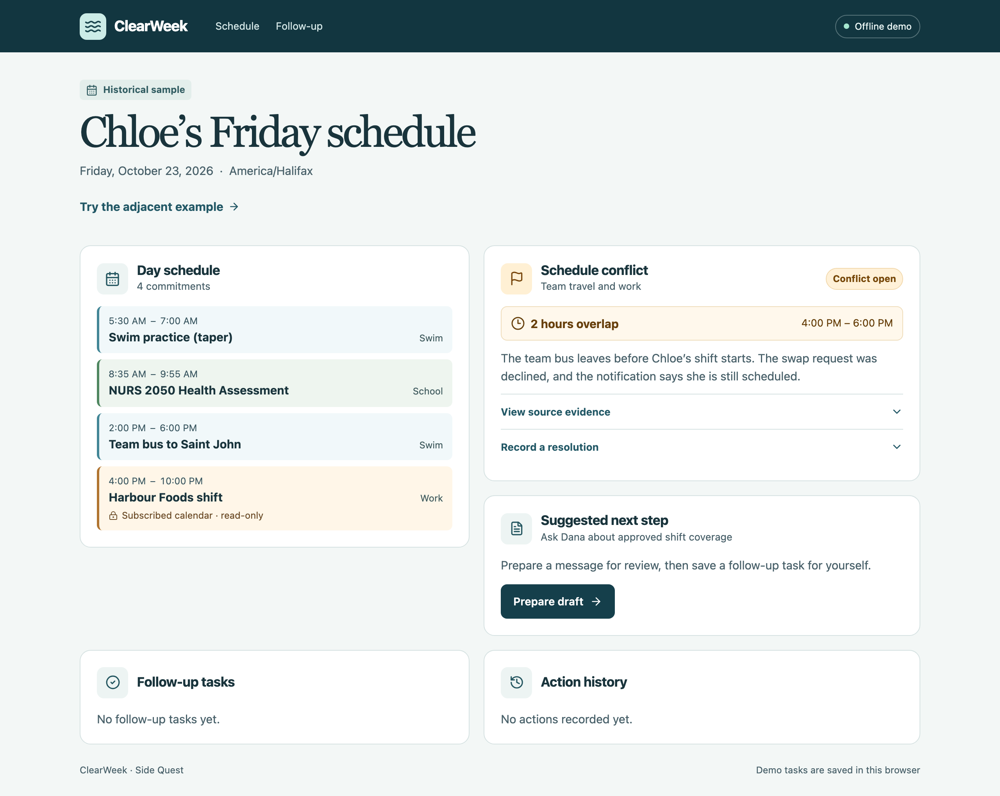

# ClearWeek

I’m Alamedin Sabit. I built ClearWeek for SideQuest’s Persona-driven AI agent stream. ClearWeek is a web app, built with TypeScript, Next.js and React, that helps Chloe Nguyen, a nursing student, varsity swimmer, and part-time cashier, decide what to do when her team bus and her work shift overlap. Plain code that does the math, with no AI, finds the overlap. In the signed-in version, Gemini makes one small choice about how to word a message to her manager Dana, and the server writes every sentence about times and facts. ClearWeek does not send messages or change shifts.

## How the AI is used

- Plain code finds the overlap between the team bus (2 to 6 PM) and the shift (4 to 10 PM): two hours, 4 to 6 PM.
- Gemini is used only in the signed-in version. It picks one of two ways to word the ask (coverage or guidance) and up to two verified details to include (the declined swap, the overdue availability update). The server rejects anything else.
- The server writes every factual sentence from fixed wording that is tied to the evidence.
- Gemini has no tools and takes no actions. It cannot send a message or change a shift.
- The open demo (no sign-in) makes no AI calls. Its draft is a prepared example.

## Live demo and verification

- **Live open demo:** <https://clearweek-woad.vercel.app> (no sign-in, sample data, no AI calls, no secrets).
- **Verified:** November 7, online: one fresh Gemini response with recorded token usage, and one approved task that was still there after a reload, saved in the online database (Supabase). November 9, local: lint, type checking, 28 unit tests, the four original browser tests plus one new conflict test, the production build, and disposable PostgreSQL checks passed.
- **Not verified:** a real second online account, and the online database's per-user access rules checked with a second user's token. Only the open demo is public; the signed-in version is not.

Details: [verification record](docs/test-results.md) · [hosted evidence](docs/hosted-evidence.md).

## The scheduling problem

On Friday, October 23, 2026 in Halifax, Chloe’s team bus was scheduled from 2 to 6 PM and her Harbour Foods shift from 4 to 10 PM. The calendar in Chloe’s screenshots shows both blocks. The shift detail shows the work calendar is view only, and a notification says her Friday swap was declined. (Screenshot file names are in the [source evidence](docs/evidence.md).) [Source evidence](docs/evidence.md)

ClearWeek calculates the two-hour overlap and shows where each fact came from. Chloe prepares a draft asking Dana about coverage, reviews or edits it, and approves the current version to create one follow-up task. The task survives reload. The conflict stays open until Chloe records supporting information about its resolution.

## Screenshots

These captures show the open demo with sample data from Chloe’s October 2026 screenshots. [Mobile screenshot](docs/screenshots/offline-mobile.png)



## Repository and live demo

- **Repository:** <https://github.com/Lameda12/ClearWeek> (`main` is the app; the extraction experiment is on the separate `feature/schedule-extraction` branch, off by default).
- **Live open demo:** <https://clearweek-woad.vercel.app>. Verified on November 9, 2026 in a real browser: the page loads with the "Open demo" label, evidence opens, the prepared draft can be edited (labelled "Edited by you"), reviewed and approved, the task survives reload, a resolution can be recorded, the mobile and desktop layouts render, and the adjacent example loads, with 0 browser errors and the only network host being the deployment itself. The deployment has **no environment variables**: no Gemini or Supabase secrets and no extraction flag. Its signed-in API routes return HTTP 401 without a token (`/api/proposal`, `/api/workspace`), so visitors cannot trigger a provider call or reach hosted data. The signed-in version (Gemini and Supabase) is **not** deployed. It was deployed from commit `661e559` by the Vercel CLI, so it only changes when redeployed.

## Verified results

Full details, dated history and the not-verified list are in the [verification record](docs/test-results.md).

- **Local, November 9, 2026:** lint, type checking, 28 unit tests, the four original browser tests plus one new conflict test against the production server, a production build, and disposable PostgreSQL checks all passed.
- **Online, November 7, 2026 (redacted [evidence](docs/hosted-evidence.md)):** one fresh Gemini response with recorded usage, and one approval that survived reload. That approval was saved before the app started checking where drafts came from, so it loads as *legacy, could not be checked*. No new provider call was made since.
- **Not checked:** a real second signed-in online account (the mocked non-owner check passes), the online database's per-user access rules with a second user's token, and the signed-in version on a public deployment (only the open demo is deployed).

## Research note: extraction experiment

A small fine-tuned model scored well on a custom split of public calendar dialogues (adapter test: positive-only exact match 0.973, span F1 0.987, n=558 with 188 positive; base model 0.133 and 0.333) and reproduced locally on a Mac. It was **not reliable on initial ClearWeek-style messages** (wrong slots, omissions, no event structure), and the app route and UI have **not** been tested with the real model. The experiment is not part of the app and lives on a separate branch with the flag off by default. Details, numbers and limits: [research note](docs/research-note.md). Dataset: Google Schema-Guided Dialogue (CC BY-SA 4.0). Model: Qwen3-1.7B (Apache 2.0).

## Run the open demo

Use Node.js 22 or later.

```sh
npm ci
npm run build
CLEARWEEK_MODE=demo npm run start -- --hostname 127.0.0.1
```

Open [ClearWeek on localhost](http://127.0.0.1:3000). Build once before the showcase, then start the production server. Run the build again after editing code. The open demo needs no credentials. It shows a prepared example draft and saves approvals, tasks and resolution records in this browser. Use a fresh browser profile or clear this site's data to start over.

1. Open **View source evidence** in the conflict card.
2. Click **Prepare draft**, edit the message, then click **Review draft**.
3. Click **Approve & create task** and open **Follow-up**.
4. Reload to see the saved task and open conflict. Use **Record a resolution** only if you have supporting information. Use clearly labelled example evidence when rehearsing.

## Signed-in setup

1. Create a Supabase project and apply the migration in `supabase/migrations` through the SQL editor or your linked CLI. Disable public sign-ups and create a dedicated email/password user in Auth. Copy that user's UUID.
2. Copy `.env.example` to `.env.local`. Set `CLEARWEEK_MODE=private`, `CLEARWEEK_OWNER_ID`, `SUPABASE_URL`, `SUPABASE_PUBLISHABLE_KEY`, and `SUPABASE_SECRET_KEY`. The publishable key and project URL reach the browser. The secret key stays on the server.
3. In Google AI Studio, create a key for a dedicated project with billing unlinked. Set `GEMINI_API_KEY`, keep `GEMINI_MODE=free`, and use `GEMINI_MODEL=gemini-3.1-flash-lite`. The route refuses models whose pricing has not been built into the guard. Keep all secrets in environment settings.
4. Restart, sign in, and prepare one draft. Confirm the Gemini label, then approve and reload. Verify the owner row and token counts in Supabase. For Vercel, import the project using the Next.js preset, set the same environment variables for private deployments, and repeat this check on the deployed HTTPS URL. A public showcase can use the open demo with no secrets.

## Verify the hosted workflow once

Use a fresh test owner with no ClearWeek actions or AI requests in the hosted project. Apply the migration and configure the owner and Gemini credentials as described above. In AI Studio, verify that the key belongs to a project with billing unlinked. Add the following to your ignored `.env.local` alongside the private configuration, replacing the placeholders locally.

```dotenv
GEMINI_MODE=free
GEMINI_PAID_CAP_VERIFIED=false
CLEARWEEK_SMOKE_FREE_TIER_CONFIRMED=true
CLEARWEEK_SMOKE_EMAIL=your-test-owner-email
CLEARWEEK_SMOKE_PASSWORD=your-test-owner-password
```

From the project folder, run these commands. Install the browser once and build again after code changes.

```sh
npx playwright install chromium
npm run build
node --env-file=.env.local node_modules/@playwright/test/cli.js test --config playwright.live.config.ts
```

The runner starts the production app on port 3188. It checks anonymous denial, signs in as the owner, and clicks **Prepare draft** once with provider retry disabled. It requires a fresh hosted ledger entry with Gemini usage counts, then clicks **Review draft** and **Approve & create task**. It checks the hosted approval row and the task after reload, replays the exact approval, and verifies the row is unchanged. Finally it checks that anonymous requests cannot read the task through either ClearWeek or Supabase. The run leaves the approved task in the test workspace. Keep existing ledger entries and use a fresh test owner for a separate first-call check.

## Architecture and limits

Next.js (App Router), TypeScript, Zod, Supabase and Gemini 3.1 Flash-Lite (`gemini-3.1-flash-lite`).

- **Plain code, no AI:** `lib/scenario.ts` computes overlaps from event times that are tied to the evidence, in America/Halifax time.
- **Gemini, small role (signed-in version only):** `app/api/proposal/route.ts` asks Gemini to choose one of two framings and up to two detail IDs. `lib/suggestion.ts` rejects anything else. `lib/workflow.ts` assembles the message from fixed wording. Gemini is given no tools and takes no actions. The open demo makes no AI calls.
- **Where each draft came from:** a draft records its source (`demo` or `gemini`) separately from whether you edited it. Unedited Gemini drafts carry a server-issued HMAC proof; edited drafts carry their verified original. The browser's claim of origin is never trusted. Edits require a fresh review. Labels: "Gemini-assisted draft · checked by the server", "Edited by you · based on an AI suggestion checked by the server", "Open demo draft".
- **Duplicates and conflicts:** an exact replay of a saved approval is idempotent. Any different draft, text or version returns HTTP 409 and changes nothing. The open demo enforces the same rule against its browser storage and shows "A different follow-up is already saved. Nothing was changed." This relies on the table's primary key, so concurrent conflicting approvals have one winner.
- **Authorization:** the app accepts only the Supabase user in `CLEARWEEK_OWNER_ID`, and then talks to Postgres with the server-side secret key. That key bypasses row-level security, so RLS protects direct database access (for example with the publishable key) but is not what protects the app's endpoints. These are tested separately; see the [verification record](docs/test-results.md).
- **Quota:** the request ledger is global to the Supabase project: 20 attempts in total, 1 per minute, 5 per 24 hours, and a $4.00 reserved-spend cap. Each attempt reserves $0.005 before the call and failed attempts keep their reservation. At 20 attempts the worst case is $0.10. Cost figures use the official paid-tier prices checked on November 9, 2026 and are estimates.
- **Time display:** formatted by hand from Halifax clock fields ("4:00 PM"), so it does not depend on the runtime's locale data.

The app uses fixed sample schedules and does not import calendars, contact employers, send messages, or change shifts. The synthetic example shows that exactly adjacent events have no time overlap and leaves travel time outside the calculation. [Recording script](docs/demo-script.md) · [Submission drafts](docs/submission/checklist.md)

## Checks and handoff

```sh
npm run lint
npm run typecheck
npm test
npm run build
npx playwright install chromium
npm run test:e2e
```

The hosted check in the previous section was written for a fresh owner. It now also asserts that the draft carries a server proof.

The [SQL checks](tests/postgres.sql) run with `psql -f tests/postgres.sql` in a fresh disposable Postgres database as its administrator. They create mock Supabase roles and an Auth schema. See the [test results](docs/test-results.md), [source evidence](docs/evidence.md), [work plan](docs/plan.md), [decisions](docs/decisions.md), [pitch](docs/submission/pitch.md), and [demo script](docs/demo-script.md).
